<!-- ✦ ALYAMAMAH AHMAD | DEVELOPER PROFILE ✦ -->

  

---

## ✦ About Me

Hello! I'm Alyamamah Ahmad, a Software Engineering graduate passionate about building modern digital experiences.

- 💻 Interested in Full-Stack Development.
- 🎨 Passionate about UI/UX Design.
- 🌱 Always learning and exploring new technologies.
- ✨ Love turning ideas into functional digital solutions.
- 🚀 Focused on growing as a developer.

---

## ✦ Tech Stack & Tools

---

## ✦ Featured Projects

### 01. Graduation Project

A software engineering graduation project.

[View Repository](https://github.com/AlyamamahAhmad/graduation-project)

### 02. CRUDs Project

A project focused on Create, Read, Update and Delete operations.

[View Repository](https://github.com/AlyamamahAhmad/Cruds-project)

---

## ✦ GitHub Statistics

  

---

---

### Where ideas meet code. 💜

Designed & built by Alyamamah Ahmad

 

